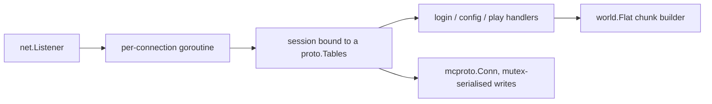

# mcgo — Lean Minecraft Server Specification

**Status:** draft v1.0 (as-built) · **Primary target:** Minecraft Java Edition 26.3 (protocol 777) · **Also:** 1.21.8 (772), 26.2 (776) · **Language:** Go 1.27, standard library only · **Mode:** offline

---

## 0. Summary

A from-scratch Minecraft Java Edition server built around three constraints:
**lowest feasible RSS**, **lowest feasible compute**, and **modularity** — with
version isolation strong enough that supporting a new game version is one
generation run plus one map entry.

It is verified against a real vanilla 26.3 client: joins, renders, chats, and
stays connected. It is **not** feature-complete: it implements 31 of the 260
packet types in protocol 777 (§10).

---

## 1. Goals and measured results

| # | Goal | Result |
|---|------|--------|
| G1 | Lowest RSS | **8.3 MB** idle, 11.9 MB peak |
| G2 | Lowest CPU | idle ≈ 0; 20 Hz tick loop not yet needed |
| G3 | Memory safety | no `unsafe`, no cgo |
| G4 | Modular | new packet = one generated table row + one handler |
| G5 | Version isolation | 772 / 776 / 777 selected from the handshake |
| G6 | Fast iteration | clean build ≈ 4 s |
| G7 | Correct | vanilla client joins and renders |

Binary 6.5 MB including 263 KB of embedded registry NBT.

---

## 2. Architecture



| Package | Responsibility |
|---------|----------------|
| `internal/mcproto` | VarInt/String/buffer primitives, packet framing, zlib, write mutex |
| `internal/proto` | `Tables` contract + shape helpers (version-independent) |
| `internal/proto/v{772,776,777}` | generated packet IDs, registries, tags, blocks, NBT blob, tables |
| `internal/world` | flat chunk builder (version-agnostic, takes IDs as config) |
| `internal/server` | session state machine: `server.go`, `login.go`, `config.go`, `play.go` |
| `tools/` | generators (see §4) |

Dependencies point one way: `server → {proto, world} → mcproto`.
`mcproto` never imports a version package.

---

## 3. Version dispatch

The handshake carries the client's protocol number. `Server.handle` looks it up
in a map and binds the connection to that version's `proto.Tables`; every
handler reads IDs and data from the session's table, never from a version
package directly.

```
protocol 772 → v772.Tables   (1.21.8)
protocol 776 → v776.Tables   (26.2)
protocol 777 → v777.Tables   (26.3)
```

`proto.Tables` carries packet IDs, the known-pack string, shape flags
(`LoginSuccessHasSessionID`, `PlayLoginHasOnlineMode`,
`SetDefaultSpawnHasDimension/HasPitch`), block-state IDs, registry entry lists,
tags, and the registry NBT blob. Adding 26.4 = run the generators + add one map
entry. Unknown protocol numbers are closed.

---

## 4. Generated data pipeline

Everything version-specific is generated from the vanilla server jar and its
data generator reports. Nothing is hand-copied from documentation.

| Script | Input | Output |
|--------|-------|--------|
| `gen_protocol.py` | `packets.json`, data pack | packet ID constants, registry entry lists, block IDs |
| `gen_tags.py` | data pack + `registries.json` | tag → raw IDs, synchronized **and built-in** registries |
| `gen_registry_nbt.py` | data pack | network NBT per registry entry (length-prefixed blob) |
| `gen_blockstates.py` | `blocks.json` | block-state id lookup blob |
| `gen_items.py` | `blocks.json`, `registries.json` | item names/ids, item → block state, container menus, furnace lit states |
| `gen_recipes.py` | data pack, `registries.json`, item components | cooking recipes, fuel burn times, crafting recipes, craft remainders |
| `gen_tables.py` | `packets.json` + `version.json` | the `proto.Tables` literal |
| `project_light.py` | both versions' `blocks.json` + the donor `dampening.bin` | a dampening blob for a version whose classes cannot be dumped |

To reproduce for a version:

```
java -DbundlerMainClass=net.minecraft.data.Main -jar server.jar --reports --output generated
python3 tools/gen_protocol.py   generated/reports server.jar internal/proto/vXXX
python3 tools/gen_tags.py       generated/reports server.jar internal/proto/vXXX
python3 tools/gen_registry_nbt.py server.jar            internal/proto/vXXX
python3 tools/gen_blockstates.py generated/reports      internal/proto/vXXX
python3 tools/gen_items.py      generated/reports       internal/proto/vXXX
python3 tools/gen_recipes.py    generated/reports server.jar internal/proto/vXXX [fuel_reports fuel_jar]
python3 tools/gen_tables.py     generated/reports server.jar internal/proto/vXXX
```

`gen_recipes.py` takes an optional fuel source: 26.2 and 1.21.8 store fuel
values in code, not in item components, so their fuel tables are projected from
the newest version's components by item name. Burn times have been stable
across these versions.

Container menus (which block opens what, its size and its title key), furnace
lit-state pairs, item name tables and the crafting/cooking recipe tables are all
generated, so adding a menu means adding data, not hand-written tables.

---

## 5. Protocol layer

Framing: `VarInt length` + `VarInt packet id` + payload. **Compression is
disabled** (no Set Compression): pure CPU saving, and vanilla clients accept an
uncompressed stream. `mcproto.Conn` serialises writes with a mutex because
keep-alive and chat echo can both write.

---

## 6. Session state machine (as built)

```
handshake → status (any protocol) | login
login:     hello → login_finished [+ session UUID if ≥776] → acknowledged
config:    update_enabled_features → select_known_packs → ←client packs
           → registry_data ×N (with NBT) → update_tags → finish_configuration
           → ←ack
play:      login → game_event(13) → chunks ×25 → set_center_chunk
           → set_default_spawn_position → set_simulation_distance
           → player_position → [keepalive 15 s] → dispatch loop
```

---

## 7. Registry strategy

The client negotiates the `minecraft:core` known pack, so registry NBT is
omitted and each Registry Data packet carries names only (~7 KB total instead of
263 KB). The full-NBT blob is retained and still sent when a client selects no
pack, which is why `gen_registry_nbt.py` survives.

Two rules make or break this phase:

1. **List every synchronized registry the vanilla server lists, and list its
   entries in the same order.** The packet defines each entry's numeric ID, so a
   missing registry or a reordered list leaves the client with unbound
   references and it disconnects during resolution — after `finish
   configuration`, having parsed everything.
2. **Tags must be sent in full**, including for built-in registries (`item`,
   `block`, …), because tag data is never sourced from packs.

Both are verifiable against a real server rather than by reading a wiki: run the
vanilla server on a spare port and dump both configuration streams (§11).

As of 26.3 that is **32 synchronized registries / 432 entries** and
**15 tag registries / 773 tags** (58754 bytes — byte-identical to vanilla's).


---

## 8. World model

One canonical superflat chunk is built once and cached; only the chunk
coordinates differ per send. 24 sections for a 384-block world, two non-empty
(bedrock/dirt/dirt/grass at y 61–64), indirect paletted containers
(bits-per-entry 4), single-value plains biome, 9-bit heightmaps
(`world_surface`, `motion_blocking`), and sky light for the 16 sections at or
above the surface with the rest declared empty.

A 5×5 chunk grid is sent because **the client will not render a chunk lacking
neighbours** — 3×3 renders as a single chunk.

Wire-format details verified against the client's own codecs:

| Field | Encoding |
|-------|----------|
| Heightmap data | `readLongArray` = VarInt count + longs |
| Chunk data | `byteArray` = VarInt length + bytes |
| Paletted container | bpe byte, palette, **fixed-size** long array |
| Light arrays | `byteArray(2048)` = VarInt length + bytes |
| **Light masks** | **`BitSet` = VarInt byte length + little-endian bytes** |

---

## 9. Budgets and measurement

| Metric | Target | Actual |
|--------|--------|--------|
| RSS idle | < 12 MB | 8.3 MB |
| Binary | < 8 MB | 6.5 MB |
| Clean build | < 5 s | ~4 s |
| Join payload | — | ~1 MB |

RSS is read from `/proc/<pid>/status`. Per-connection state is a small
`session` struct; chunk payloads are computed once per version and cached.

---

## 10. Parity gap

Implemented: 39 of 260 packet types (15%).

| State | Implemented | Total |
|-------|-------------|-------|
| handshake | 1 | 1 |
| status | 4 | 4 |
| login | 4 | 11 |
| configuration | 11 | 31 |
| play clientbound | 13 | 144 |
| play serverbound | 11 | 69 |

Major missing subsystems, roughly by cost:

1. **World generation** — noise, biomes, features, carvers, structures.
2. **Lighting engine** — propagation and incremental updates.
3. **Tick loop** — scheduled/random ticks, fluids, redstone.
4. **Entities** — registry, metadata, tracking, AI, spawning.
5. **Player systems** — inventory/containers, crafting, health, XP, scoreboard,
   tab list, signed chat.
6. **Interaction** — block placement/breaking with the sequence-ack protocol.
7. **Persistence** — Anvil region files, `level.dat`, player data.
8. **Services** — online mode (encryption + session auth), RCON, query,
   whitelist/ops, commands (Brigadier tree).

Full behavioural parity additionally means matching vanilla's game rules
bit-for-bit — realistically a multi-year effort, not a milestone.

---

## 11. Lessons

- **A real server's own stream is the best oracle.** The bug that survived days
  of wiki-reading was found by running vanilla 26.3 on a spare port and diffing
  the two configuration streams with `tools/mcdump`: vanilla sent 32
  synchronized registries, we sent 29, and the client died at resolution
  (`diff` of one line per registry). Build the oracle before guessing twice.
- Spec text got close and then misled twice: `Update Tags` looked correct, and
  the heightmap prefix I suspected was actually right.
- Every real bug was found in the **client jar** (`javap` on the codec) or the
  **vanilla data pack** (directory diff), never by re-reading the wiki.
- Generated-from-vanilla beats transcribed-from-docs for anything version-
  volatile: the two missing registries were caught by a directory diff.
- Packet-level tracing (`-> 0x2E len=37717`) turned a generic "Network Protocol
  Error" into a specific packet in one round trip. Build that in early.

---

## 12. Gap inventory

Derived by diffing the 26.3 play-state packet list (`reports/packets.json`)
against what the server implements, and checking each subsystem against
observed client behaviour. Packet IDs below are 26.3 (777) and are generated,
never transcribed.

**Implemented:** handshake/status/login/configuration, chunk grid at spawn,
block place/break, block updates + light, world time, keep-alive, system chat,
creative inventory, player abilities, position/hotbar persistence, and signs
(the first block entity).

### 12.1 Block entities — *partially done (signs only)*
Signs now work end to end (`Open Sign Editor` 61 → `Update Sign` 62 →
`Block Entity Data` 6, text persisted and carried in chunk payloads). Still
missing: chests, furnaces, hoppers, banners, beds, beacons, lecterns.
Also `Block Entity Tag Query` 2 (serverbound), used by structure blocks.
**Impact:** nothing else that stores state opens or survives a relog.

### 12.2 Container screens — *chests/barrels done; other menus not*
Chests, trapped chests and barrels open a real 27-slot window:
`Open Screen` (60, menu `minecraft:generic_9x3` = 2), `Set Container Content`
(18) carrying the container's 27 slots plus the player's 36, and serverbound
`Click Container` (18) applying plain clicks (mode 0 — pick up, put down,
merge, swap). Contents persist in `containers.json`.
The player's whole 36-slot storage (main + hotbar) is now tracked, which the
container window needs and which also makes `Set Creative Mode Slot` handling
correct beyond the hotbar.
Still missing: shift-click, hotkey, drag and double-click modes; furnaces,
crafting tables, hoppers, shulkers, and every other menu type; and
`Container Set Slot`/`Set Data` (we resend the whole window instead, which is
cheap at this size).
**Impact of the remainder:** those UIs do not open, and clicking with a
modifier key does nothing.

### 12.3 Chunk streaming around the player — *done*
Chunks now follow the player: `Set Center Chunk` (94) is sent on every chunk
crossing, an 11×11 grid (radius 5) is streamed, and anything outside it is
dropped with `Forget Level Chunk` (38). The streamed radius is also what the
join packet advertises as the view distance, so the client never expects a
chunk that was not sent.
Still missing: chunk batching (`Chunk Batch Start` 12 / `Finished` 11,
serverbound `Chunk Batch Received` 11), which only affects pacing.
**Impact of the gap:** walking away from spawn used to show void and grow
client memory without bound; anything outside the fixed spawn grid — signs
included — never reached a client that was elsewhere.

### 12.4 Entities and other players — *players visible; no mobs*
The tab list works: on join every session is sent `Player Info Update`
(71, actions add | game mode | listed | latency) for every player including
itself, the newcomer's info is pushed to everyone else, and `Player Info
Remove` (70) is broadcast on disconnect. `Tab List` (125) carries a header and
footer.
Players are now visible in the world too: each session gets an entity id, and
the newcomer and the existing sessions exchange `Add Entity` (1, type
`minecraft:player`) with positions; movement is relayed as
`Move Entity Pos Rot` (55) with deltas and `Rotate Head` (85), and
`Remove Entities` (78) despawns on disconnect.
Still missing: `Set Entity Data` (101) — no player metadata (skin layers, pose,
health) is sent, so appearance is whatever the client defaults to — plus
`Entity Event` (34), `Teleport Entity` (128) for long jumps, and every non
player entity (mobs, items, projectiles).

### 12.5 Health, damage, death, respawn
`Set Health` 106, `Damage Event` 25, `Hurt Animation` 43, `Respawn` 84,
serverbound `Client Command` 12.
**Impact:** godmode only; no death/respawn loop; no fall damage.

### 12.6 Recipes
`Update Recipes` 136, `Recipe Book Add` 76 / `Remove` 75 / `Settings` 77,
`Place Ghost Recipe` 64, serverbound `Place Recipe`.
**Impact:** recipe book empty; no crafting from the book.

### 12.7 Commands
`Commands` 16, `Command Suggestions` 15, serverbound `Chat Command` 7/8,
`Command Suggestion` 15. Brigadier tree is derivable from `reports/commands.json`.
**Impact:** `/` does nothing.

### 12.8 Chat completeness — *player chat done*
Messages now broadcast to every session as `Disguised Chat` (33 in 26.3, 29 in
1.21.8 — the id shifts, which is why it is generated), with the sender's name
and chat type 0 (`minecraft:chat`, the first entry of the synchronized
`chat_type` registry). That is the unsigned path: it renders as a normal player
message without chat signing.
Not implemented, and not needed unless signing or moderation is wanted:
`Player Chat` (58) with signatures, `Delete Chat` (27), and the serverbound
`Chat Ack` (6) / `Chat Session Update` (10) pair.

### 12.9 Block breaking fidelity
Break progress is client-driven; the server insta-breaks on `Started`.
Missing: destroy-stage broadcast, `Stop Destroy Block`, per-block hardness and
tool speed.

### 12.10 Sounds, particles, animations
`Sound` 119, `Sound Entity` 118, `Level Particles` 48, `Swing Animation` 123.
**Impact:** no audio/visual feedback for actions.

### 12.11 Item components
The component payload of `Set Creative Mode Slot` is ignored, and items are
re-sent with zero components. **Impact:** enchanted, potion, and named items
lose their data across a reconnect.

### 12.12 World state
Weather (`Game Event` 7/8), `Change Difficulty` 10, game rules; serverbound
`Change Difficulty` 4 and `Change Game Mode` 5 are ignored.

### 12.13 Scoreboard, advancements, statistics, boss bar
`Update Advancements` 133, `Award Statistics`, objective/score packets,
`Boss Event` 9. **Impact:** cosmetic; safe to defer.

### Priority

1. **Container screens** (12.2) — unblocks chests/crafting, the most-missed.
2. **Chunk streaming** (12.3) — without it, everything else is bounded to spawn.
3. **Entities / other players** (12.4) — the defining multiplayer feature.
4. **Health & death** (12.5), **recipes** (12.6), **commands** (12.7).
5. The rest (12.9–12.13) is polish.

### Method note

The productive oracle is **the vanilla data**, not the wiki prose:
`reports/packets.json` for IDs, the data pack for registry content, and
`javap` on the client jar for **wire shapes** (`Slot` leading with its count,
`KnownPack.vanilla` using `WorldVersion.id()`, `KnownPacksManager` intersecting
by record equality). Every structural bug in this project was found that way;
the wiki alone was wrong or silent each time it mattered.
